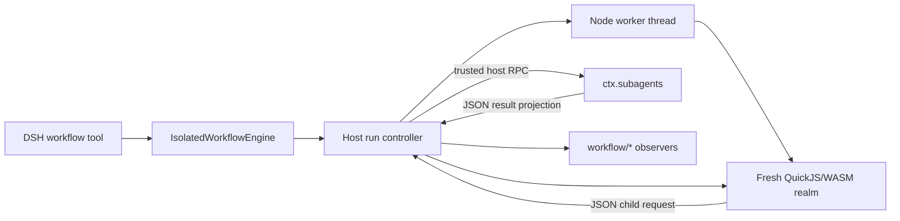

# dsh-workflow-isolate

[](https://github.com/Linxiushen/dsh-workflow-isolate/actions/workflows/ci.yml)

[简体中文](README.zh-CN.md) | [Architecture](docs/architecture.md) | [Security model](docs/security-model.md) | [Compatibility](docs/compatibility.md)

`dsh-workflow-isolate` is a drop-in `WorkflowEngine` for [DeepSeek Harness](https://github.com/deepseek-ai/deepseek-harness) that runs model-written orchestration scripts in QuickJS/WASM. It preserves the DSH workflow hooks and lifecycle events while adding an independent JavaScript runtime, bounded guest memory and stack, interrupt fuel, a host wall deadline, forced worker termination, and child-agent budgets.

DeepSeek Harness's official worker-thread engine deliberately uses `node:vm` as an API-shaping mechanism. Its documentation states that it [is not a security boundary](https://github.com/deepseek-ai/deepseek-harness/blob/99f6f02fecdb7dff40c3fbc9470f5907c29f74ca/packages/workflow/workflow-worker-thread/README.md#trust-and-isolation-boundary) and calls for a different engine when scripts are not trusted. This project explores that engine seam without changing the model-facing `workflow` tool.

> [!IMPORTANT]
> QuickJS/WASM is a stronger language boundary than `node:vm`, not a claim of perfect isolation. The host-side subagent provider remains trusted and can use its configured model, tools, network, and credentials. Runtime vulnerabilities, side channels, supply-chain compromise, and host denial of service remain relevant. Read the [security model](docs/security-model.md) before deploying it across trust boundaries.

## Why this exists

Model-written workflow code sits in an unusual middle ground: it needs enough JavaScript to coordinate many agents, but it should not inherit Node.js authority merely because the harness is written in Node. `dsh-workflow-isolate` narrows that gap:

- A fresh QuickJS runtime and realm are created for every workflow run.
- The guest receives only `args`, `agent`, `parallel`, `pipeline`, `phase`, and `log`; no `process`, `require`, Node module loader, filesystem, network, or timers are injected.
- Only a plain-JSON projection crosses the guest boundary. Functions and symbols cannot cross; cycles, sparse arrays, non-finite numbers, and exotic prototypes are rejected.
- QuickJS heap, stack, and interrupt-fuel limits constrain script computation. A host wall deadline and worker termination cover code that does not cooperate with cancellation.
- Concurrency, total-agent, and per-combinator item caps bound orchestration fan-out.
- Child agents stay on the host and are reached only through a narrow RPC bridge to the configured DSH subagent provider.
- The engine preserves `WorkflowRun`, never-rejecting results, bounded disposal, and paired `workflow/*` lifecycle events expected by DSH consumers.

## Architecture



The Node worker is a lifecycle and termination container. The QuickJS runtime inside it is the language boundary: guest constructors and prototypes belong to QuickJS, not V8, and no Node object is intentionally placed in the realm. See [Architecture](docs/architecture.md) for the run sequence and [Threat model](docs/threat-model.md) for boundary assumptions.

## Compatibility status

The current release targets `@deepseek-ai/dsh-workflow@0.1.0-rc.7` and the associated DSH `0.1.0-rc.7` workflow packages. DSH's workflow API is still a release candidate, so compatibility is intentionally version-bounded.

The following surfaces are retained:

- `ctx.workflowEngine` service provider
- `WorkflowStartRequest`, `WorkflowRun`, and `WorkflowResult`
- `agent`, `parallel`, `pipeline`, `phase`, `log`, and `args`
- structured child output through DSH's supported object JSON Schema subset
- `workflow/start`, `workflow/phase`, `workflow/log`, `workflow/agent-start`, `workflow/agent-end`, and `workflow/end`
- per-run subagent-provider and total-agent policy overrides

QuickJS is not V8. Workflow bodies must use portable JavaScript and cannot depend on Node APIs, V8-only behavior, dynamic module loading, or ambient timers. Error text and stack formatting may also differ. The detailed behavior matrix is in [Compatibility](docs/compatibility.md).

### Benchmark

`pnpm benchmark` measures cold and warm fresh-runtime overhead and prints median/p95 JSON. The Node baseline is included only as a scale reference; it is not a security-equivalent engine. See the [benchmark methodology](benchmarks/README.md).

## Install from a checkout

Prerequisites: Node.js `22.19.x` or `24.x`, pnpm `11`, a DSH `0.1.0-rc.7` installation, and a working `spawn` subagent provider.

```sh
git clone https://github.com/Linxiushen/dsh-workflow-isolate.git
cd dsh-workflow-isolate
corepack enable
pnpm install --frozen-lockfile
pnpm check
pnpm pack
```

Install the generated tarball into the DSH profile you use. A tarball includes built output and does not require a git dependency build allowance:

```sh
dsh plugin --profile web add ./dsh-workflow-isolate-0.1.0.tgz
dsh --profile web --dump-config
```

The bundled [`cordis.patch.yml`](cordis.patch.yml) disables the stock `workflow-worker-thread` row and inserts this engine. DSH permits one `ctx.workflowEngine` provider per context, so the two engines must not be mounted together.

For local source iteration, DSH also accepts a linked checkout after it has been built:

```sh
dsh plugin --profile web add .
```

## Configuration

The bundle ships with a conservative deployment profile:

```yaml
- id: workflow-worker-thread
  disabled: true

- insert:
    - id: workflow-isolate
      name: dsh-workflow-isolate
      config:
        provider: spawn
        memoryLimitBytes: 67108864
        maxInterruptTicks: 250000
        maxAgentRequestBytes: 1048576
        maxWallTimeMs: 600000
        maxConcurrentAgents: 0
        maxTotalAgents: 1000
        maxItemsPerCall: 4096
        disposeGraceMs: 3000
```

`maxConcurrentAgents: 0` asks the engine to derive a bounded value from available CPU parallelism. A profile's own `cordis.patch.yml` is applied after bundle layers and can replace this row's config. Cordis row configs replace rather than deep-merge, so restate every value you need when overriding it.

Resource limits are deployment policy, not script options. Lower them for exposed or multi-user deployments, and remember that child-agent cost is primarily controlled by `maxConcurrentAgents` and `maxTotalAgents`, not QuickJS memory.

Millisecond timer settings are capped at Node.js's maximum single-delay value (`2,147,483,647`) so oversized values cannot be clamped to an immediate timeout.

All engine defaults are listed below. The bundle patch relies on static defaults for values it does not restate.

| Key                    | Default | Purpose                                                        |
| ---------------------- | ------: | -------------------------------------------------------------- |
| `provider`             | `spawn` | Host-side subagent provider                                    |
| `memoryLimitBytes`     |  64 MiB | QuickJS guest heap ceiling                                     |
| `maxStackBytes`        |   1 MiB | QuickJS interpreter stack ceiling                              |
| `maxInterruptTicks`    | 250,000 | QuickJS interrupt-fuel budget per run                          |
| `maxScriptBytes`       | 256 KiB | UTF-8 workflow body ceiling                                    |
| `maxResultBytes`       |   1 MiB | UTF-8 serialized final-result ceiling                          |
| `maxAgentRequestBytes` |   1 MiB | UTF-8 JSON ceiling for one prompt and its agent options        |
| `maxWallTimeMs`        | 600,000 | Host-observed run deadline, including child waits              |
| `workerMemoryLimitMb`  | 128 MiB | V8 old-generation ceiling for the worker bridge                |
| `maxConcurrentAgents`  |     `0` | Auto-resolves to `min(16, max(1, availableParallelism() - 2))` |
| `maxTotalAgents`       |   1,000 | Accepted `agent()` calls per run                               |
| `maxItemsPerCall`      |   4,096 | Items per `parallel()` or `pipeline()` call                    |
| `disposeGraceMs`       |   3,000 | Cleanup grace before forced worker termination                 |

## Workflow example

The model-facing tool still receives `meta`, `args`, and a plain JavaScript function body. A body can fan research questions out through structured child calls and then synthesize the surviving results:

```js
phase("Research");

const findings = await pipeline(args.questions, async (question) =>
  agent("Investigate this question and cite concrete evidence: " + question, {
    label: question,
    schema: {
      type: "object",
      properties: {
        answer: { type: "string" },
        evidence: { type: "array", items: { type: "string" } },
      },
      required: ["answer", "evidence"],
      additionalProperties: false,
    },
  }),
);

phase("Synthesis");
const usable = findings.filter(Boolean);
const summary = await agent(
  "Synthesize these findings for " +
    args.audience +
    ":\n" +
    JSON.stringify(usable),
  { label: "Final synthesis" },
);

return { findings: usable, summary };
```

See the complete importable request fixture in [`examples/research-synthesis.mjs`](examples/research-synthesis.mjs), including metadata and sample arguments.

## Operational behavior

- Invalid metadata, script size/V8 function-body syntax, provider routes, arguments, and policy overrides fail before a run is published. QuickJS-specific compile failures settle the published run as an error.
- Once `start()` returns, `run.result` resolves rather than rejects. Completion, cancellation, and failures are represented by `stopReason`.
- Cancelling a run closes child admission, aborts pending provider starts, disposes published child runs, and interrupts QuickJS. The host terminates a worker that does not settle within the configured grace.
- Every emitted `workflow/agent-start` is paired once with `workflow/agent-end`, including host-synthesized cancellation ends after forced termination.
- Interrupt ticks are an implementation budget, not a stable cross-version instruction count. Tune them with representative workflows and re-baseline after QuickJS upgrades.
- The concrete `IsolatedRun` also exposes `metrics: Promise<IsolateMetrics>` with runtime, wall time, interrupt ticks, optional settlement-time `memoryUsedBytes`, and a termination classification. This is a project extension, not part of the upstream `WorkflowRun` interface.

## Development

```sh
pnpm install --frozen-lockfile
pnpm check
```

`pnpm check` runs linting, TypeScript validation, tests, the production build, a real worker smoke against that build, and package-surface validation. CI covers the supported Node.js lines. Security-relevant changes should include adversarial tests for escape attempts, cancellation races, budget exhaustion, and lifecycle pairing.

See [Contributing](CONTRIBUTING.md), [Security policy](SECURITY.md), and the [Changelog](CHANGELOG.md).

## Project status

This is an independent, experimental provider for a release-candidate DeepSeek Harness seam. It is not an official DeepSeek project and has not been independently audited. The `0.x` version line may track breaking changes in DSH until the upstream workflow API stabilizes.

## License

[MIT](LICENSE)
