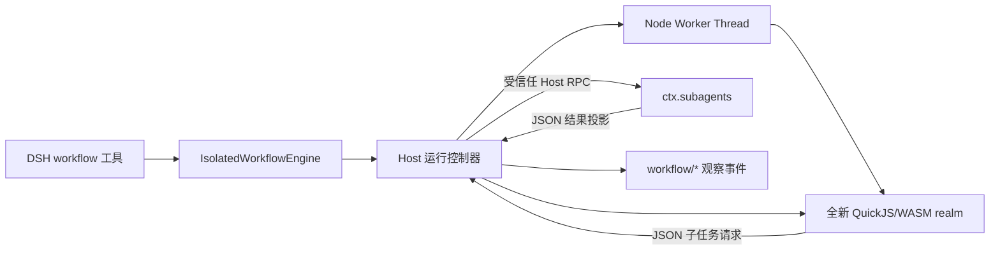

# dsh-workflow-isolate

[](https://github.com/Linxiushen/dsh-workflow-isolate/actions/workflows/ci.yml)

[English](README.md) | [架构](docs/architecture.md) | [安全模型](docs/security-model.md) | [兼容性](docs/compatibility.md)

`dsh-workflow-isolate` 是一个面向 [DeepSeek Harness](https://github.com/deepseek-ai/deepseek-harness) 的可替换 `WorkflowEngine`。它在 QuickJS/WASM 中运行模型生成的编排脚本，在保留 DSH 工作流钩子和生命周期事件的同时，增加独立 JavaScript 运行时、Guest 堆与栈上限、中断 fuel、Host 侧墙钟超时、Worker 强制终止以及子 Agent 预算。

DeepSeek Harness 官方的 Worker Thread 引擎有意把 `node:vm` 用作 API 整形机制。其文档明确说明 [`node:vm` 不是安全边界](https://github.com/deepseek-ai/deepseek-harness/blob/99f6f02fecdb7dff40c3fbc9470f5907c29f74ca/packages/workflow/workflow-worker-thread/README.md#trust-and-isolation-boundary)，并指出不可信脚本需要同一工作流 seam 后面的另一种引擎。本项目正是对这一引擎扩展点的实现，不改变模型所看到的 `workflow` 工具。

> [!IMPORTANT]
> QuickJS/WASM 提供了比 `node:vm` 更强的语言运行时边界，但这不等于“绝对安全”。Host 侧 subagent provider 仍受信任，并能使用其配置的模型、工具、网络和凭据；运行时漏洞、侧信道、依赖供应链攻击与 Host 拒绝服务仍在风险范围内。跨信任边界部署前请阅读[安全模型](docs/security-model.md)。

## 为什么做这个项目

模型编写的工作流脚本处于一个特殊位置：它需要足够完整的 JavaScript 来编排大量 Agent，但不应因为 Harness 使用 Node.js 编写就自动继承 Node 权限。`dsh-workflow-isolate` 通过以下机制缩小这一区间：

- 每次运行创建全新的 QuickJS runtime 和 realm。
- Guest 仅获得 `args`、`agent`、`parallel`、`pipeline`、`phase` 与 `log`；不注入 `process`、`require`、Node 模块加载器、文件系统、网络或定时器。
- Guest 边界只传递纯 JSON 投影；函数和 Symbol 无法跨越边界，循环引用、稀疏数组、非有限数值和特殊原型会被拒绝。
- QuickJS 堆、栈与中断 fuel 约束脚本计算；Host 墙钟超时与 Worker 终止处理不配合取消的代码。
- 并发 Agent 数、单次运行 Agent 总数，以及单次组合器条目数都有独立上限。
- 子 Agent 仍在 Host 侧执行，只能通过窄 RPC 桥访问已配置的 DSH subagent provider。
- 保留 DSH 消费方所依赖的 `WorkflowRun`、永不 reject 的结果、限时 dispose 和成对 `workflow/*` 事件。

## 架构



Node Worker 负责生命周期隔离和最终终止；其内部 QuickJS runtime 才是语言边界。Guest 的构造器和原型属于 QuickJS，而非 V8，并且不会被有意传入任何 Node 对象。完整运行时序见[架构文档](docs/architecture.md)，边界假设见[威胁模型](docs/threat-model.md)。

## 兼容状态

当前版本以 `@deepseek-ai/dsh-workflow@0.1.0-rc.7` 及同版本 DSH 工作流包为目标。由于上游 API 仍处于 RC 阶段，本项目刻意限制 peer dependency 范围。

保留的接口包括：

- `ctx.workflowEngine` 服务
- `WorkflowStartRequest`、`WorkflowRun` 与 `WorkflowResult`
- `agent`、`parallel`、`pipeline`、`phase`、`log` 与 `args`
- 基于 DSH 支持的 object-root JSON Schema 子集的结构化子 Agent 输出
- `workflow/start`、`workflow/phase`、`workflow/log`、`workflow/agent-start`、`workflow/agent-end` 与 `workflow/end`
- 单次运行的 subagent provider 和 Agent 总数策略覆盖

QuickJS 不是 V8。工作流必须使用可移植 JavaScript，不能依赖 Node API、V8 特有行为、动态模块加载或环境定时器；错误文本与堆栈格式也可能不同。详见[兼容性矩阵](docs/compatibility.md)。

### 性能基准

`pnpm benchmark` 会测量冷启动与热态新 runtime 的开销，并以 JSON 输出中位数和 p95。Node 基线只用于观察量级，并不是安全等价引擎。方法说明见[基准文档](benchmarks/README.md)。

## 从源码安装

前置条件：Node.js `22.19.x` 或 `24.x`、pnpm `11`、DSH `0.1.0-rc.7`，以及可用的 `spawn` subagent provider。

```sh
git clone https://github.com/Linxiushen/dsh-workflow-isolate.git
cd dsh-workflow-isolate
corepack enable
pnpm install --frozen-lockfile
pnpm check
pnpm pack
```

把生成的 tarball 安装到实际使用的 DSH profile。Tarball 已包含构建产物，不需要为 Git 依赖开启安装期构建权限：

```sh
dsh plugin --profile web add ./dsh-workflow-isolate-0.1.0.tgz
dsh --profile web --dump-config
```

随包发布的 [`cordis.patch.yml`](cordis.patch.yml) 会禁用官方 `workflow-worker-thread` 配置项并插入本引擎。每个 Cordis Context 只能存在一个 `ctx.workflowEngine` provider，因此两个引擎不能同时挂载。

本地迭代时，也可以在构建后把当前目录链接进 profile：

```sh
dsh plugin --profile web add .
```

## 配置

Bundle 默认写入以下部署策略：

```yaml
- id: workflow-worker-thread
  disabled: true

- insert:
    - id: workflow-isolate
      name: dsh-workflow-isolate
      config:
        provider: spawn
        memoryLimitBytes: 67108864
        maxInterruptTicks: 250000
        maxAgentRequestBytes: 1048576
        maxWallTimeMs: 600000
        maxConcurrentAgents: 0
        maxTotalAgents: 1000
        maxItemsPerCall: 4096
        disposeGraceMs: 3000
```

所有引擎默认值如下：

| 配置项                 |  默认值 | 含义                                             |
| ---------------------- | ------: | ------------------------------------------------ |
| `provider`             | `spawn` | Host 侧子 Agent provider                         |
| `memoryLimitBytes`     |  64 MiB | QuickJS Guest 堆上限                             |
| `maxStackBytes`        |   1 MiB | QuickJS Guest 栈上限                             |
| `maxInterruptTicks`    | 250,000 | 单次运行的 QuickJS 中断 fuel                     |
| `maxScriptBytes`       | 256 KiB | UTF-8 脚本大小上限                               |
| `maxResultBytes`       |   1 MiB | 最终 JSON 结果大小上限                           |
| `maxAgentRequestBytes` |   1 MiB | 单次 prompt 与 Agent 选项的 UTF-8 JSON 大小上限  |
| `maxWallTimeMs`        | 600,000 | Host 侧墙钟截止时间                              |
| `workerMemoryLimitMb`  | 128 MiB | Worker 桥接代码的 V8 Old Generation 上限         |
| `maxConcurrentAgents`  |     `0` | `0` 自动解析为 `min(16, max(1, CPU 并行度 - 2))` |
| `maxTotalAgents`       |   1,000 | 单次运行可接受的 `agent()` 总数                  |
| `maxItemsPerCall`      |   4,096 | 单次 `parallel()` / `pipeline()` 的条目数        |
| `disposeGraceMs`       |   3,000 | 强制终止前的取消/清理宽限时间                    |

Profile 自身的 `cordis.patch.yml` 会在 Bundle 层之后应用，可替换该配置项。Cordis 的配置项是整体替换而非深度合并，因此覆盖时请重新列出所需的全部字段。

资源上限属于部署策略，不是脚本参数。暴露或多用户环境应进一步收紧；子 Agent 的主要成本由 `maxConcurrentAgents` 和 `maxTotalAgents` 决定，而不是 QuickJS 内存。

毫秒计时配置封顶为 Node.js 单次延时允许的最大值（`2,147,483,647`），避免超大数值被运行时钳制成立即超时。

## 工作流示例

模型侧工具仍接收 `meta`、`args` 与纯 JavaScript 函数体。下面的脚本先并行调查问题，再综合可用结果：

```js
phase("Research");

const findings = await pipeline(args.questions, async (question) =>
  agent("Investigate this question and cite concrete evidence: " + question, {
    label: question,
    schema: {
      type: "object",
      properties: {
        answer: { type: "string" },
        evidence: { type: "array", items: { type: "string" } },
      },
      required: ["answer", "evidence"],
      additionalProperties: false,
    },
  }),
);

phase("Synthesis");
const usable = findings.filter(Boolean);
const summary = await agent(
  "Synthesize these findings for " +
    args.audience +
    ":\n" +
    JSON.stringify(usable),
  { label: "Final synthesis" },
);

return { findings: usable, summary };
```

[`examples/research-synthesis.mjs`](examples/research-synthesis.mjs) 提供了含 metadata 和示例参数的完整可导入请求对象。

## 运行语义

- 无效 metadata、脚本大小/V8 函数体语法、provider 路由、参数与策略覆盖会在运行发布前失败；仅 QuickJS 不支持的编译错误会在运行发布后以 error 结束。
- `start()` 返回后，`run.result` 只会 resolve，不会 reject；完成、取消与错误由 `stopReason` 表达。
- 取消会关闭新子任务准入、中止待启动 provider、dispose 已发布的子运行，并中断 QuickJS。超过宽限时间仍未结束时，Host 会终止 Worker。
- 每个已发出的 `workflow/agent-start` 都只对应一个 `workflow/agent-end`；强制终止后由 Host 补发取消结束事件。
- Interrupt tick 是实现层预算，并不是跨版本稳定的指令计数。升级 QuickJS 后应使用代表性工作流重新标定。
- 具体类型 `IsolatedRun` 还提供 `metrics: Promise<IsolateMetrics>`，包含 runtime、墙钟时间、interrupt tick、可选的结算时 `memoryUsedBytes` 与终止分类。这是本项目扩展，不属于上游 `WorkflowRun` 接口。

## 开发

```sh
pnpm install --frozen-lockfile
pnpm check
```

`pnpm check` 会依次运行 lint、TypeScript 检查、测试、生产构建、针对该构建的真实 worker smoke 与发布包表面校验。安全相关变更应覆盖逃逸尝试、取消竞态、预算耗尽和生命周期事件配对等对抗性测试。

更多信息见[贡献指南](CONTRIBUTING.md)、[安全策略](SECURITY.md)与[变更记录](CHANGELOG.md)。

## 项目状态

这是面向 DeepSeek Harness RC 工作流 seam 的独立实验性 provider，并非 DeepSeek 官方项目，也尚未经过独立安全审计。在上游工作流 API 稳定之前，`0.x` 版本可能跟随 DSH 发生破坏性变更。

## 许可证

[MIT](LICENSE)
