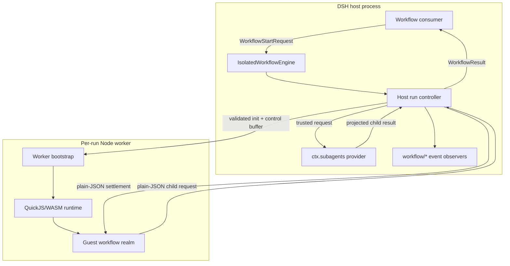
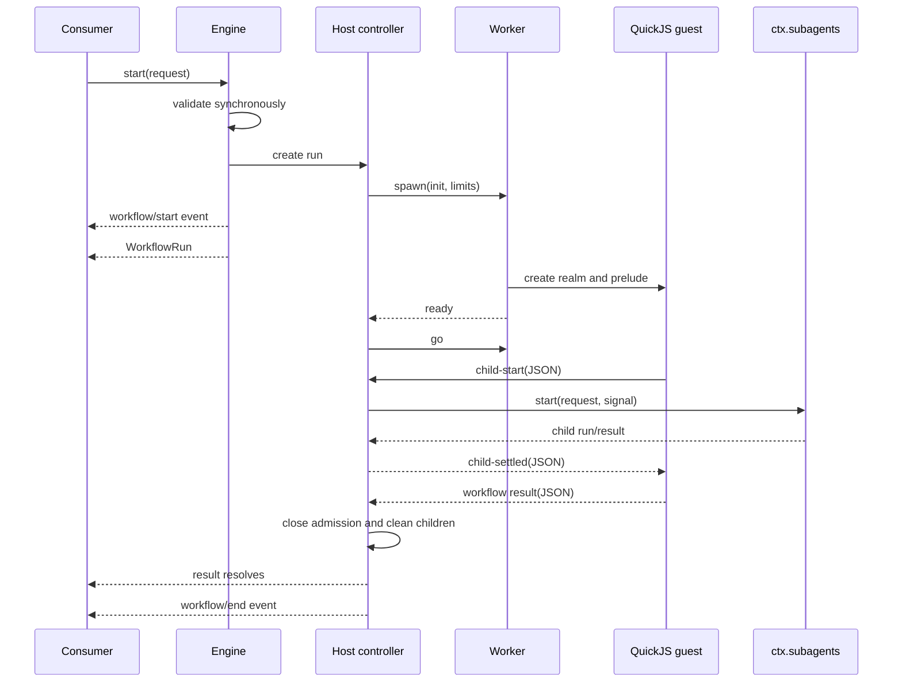

# Architecture

This document describes how `dsh-workflow-isolate` implements the DeepSeek Harness `WorkflowEngine` seam. The design goal is to keep DSH's orchestration contract while preventing workflow JavaScript from sharing the host's V8 realm or receiving Node objects.

## Components

### Engine

The Cordis plugin provides the single `ctx.workflowEngine` service used by DSH's workflow consumers. `start()` validates data that can be rejected synchronously: metadata shape, script size and V8 async-function-body syntax, JSON arguments, provider selection, and any per-run cap. It then creates the run controller and publishes `workflow/start`. QuickJS compiles the body again inside the worker, so syntax implemented by V8 but not by the pinned QuickJS build becomes a settled run error.

### Host run controller

One controller owns one worker, the canonical cancellation signal, all pending provider starts, published child runs, the event ledger, and the terminal result. It is the authority for the run lifecycle. Terminal state uses a first-claim-wins rule so a worker result, external cancellation, deadline, or worker failure cannot overwrite one another through a late callback.

### Worker bootstrap

The worker keeps synchronous guest computation off the harness event loop and gives the host a final `terminate()` mechanism. The worker itself is Node.js code and is not the guest boundary. Its job is to create QuickJS, install narrow native callbacks, move validated messages, and dispose the runtime.

The worker is started with a scrubbed environment and empty `execArgv`. A Node worker `maxOldGenerationSizeMb` limit constrains the V8 old generation used by bridge code. It is not a complete bound on WASM/external memory and does not replace QuickJS's own heap limit.

### QuickJS realm

Every run receives a fresh QuickJS runtime and context. The runtime receives:

- a guest heap limit;
- a guest stack limit;
- an interrupt handler that checks cancellation and an interrupt-fuel budget; and
- a prelude that defines and freezes the supported workflow hooks.

The guest realm receives no V8 object or Node capability. `process`, `require`, filesystem and network modules, module loading, and timers are not installed. Standard JavaScript objects are QuickJS objects whose constructor chains remain inside QuickJS.

### Host RPC

`agent()` is the only work-producing bridge. The guest callback creates a deferred QuickJS promise and sends a child request to the host. The host starts the selected DSH subagent provider and returns only the projected text or structured result. Provider execution is trusted host activity; it does not happen in QuickJS.

## Run sequence

The ready/go handshake matters: cancellation can arrive while the worker is loading QuickJS. The guest body cannot execute its initial synchronous slice until the host has admitted the run.

## Value boundaries

Only canonical JSON data crosses the guest boundary:

- `null`, booleans, strings, and finite numbers;
- dense arrays of accepted values; and
- plain objects with accepted values.

Host-side snapshots reject functions, symbols, bigint values, `undefined` below the root, cycles, sparse arrays, non-finite numbers, accessors, symbol/non-enumerable properties, and exotic prototypes. That inspection reads property descriptors rather than invoking getters. Guest-side options and results are first normalized by the sealed QuickJS prelude; only their resulting JSON data is dumped and admitted by the host snapshot. Object keys are materialized as data rather than assigned through inherited setters, preventing `__proto__` from changing the receiving object's prototype.

There are distinct boundaries:

1. The host snapshots `meta` and `args` before the worker starts.
2. Worker messages carry structured data, not handles into QuickJS.
3. Native callbacks decode values and re-encode results through JSON.
4. Child structured output is checked by DSH's supported object JSON Schema validator.
5. The final result is snapshotted and size-checked before publication.

These rules prevent object-capability leakage through ordinary workflow values. They do not validate the semantic truth of model output.

## Scheduling and budgets

The guest keeps a FIFO queue of accepted `agent()` calls. It admits at most `maxConcurrentAgents` calls to host RPC and at most `maxTotalAgents` during the run. `parallel()` and `pipeline()` separately reject input arrays over `maxItemsPerCall`.

`pipeline(items, ...stages)` advances each item independently without a cross-stage barrier. `parallel(thunks)` starts all accepted thunks and waits for their combined settlement. Ordinary child or stage failures become `null`; malformed hook calls, invalid schemas, and budget violations are fatal workflow errors.

Computation is bounded on several independent axes:

| Axis                    | Enforcement                                 |
| ----------------------- | ------------------------------------------- |
| Guest heap              | QuickJS runtime memory limit                |
| Guest call stack        | QuickJS maximum stack size                  |
| Synchronous computation | QuickJS interrupt callback and fuel counter |
| Elapsed duration        | Host wall-time deadline                     |
| Uncooperative shutdown  | Grace timer followed by worker termination  |
| Child concurrency       | Guest admission queue                       |
| Total child calls       | Per-run counter                             |
| Fan-out input           | Per-combinator item cap                     |
| Agent request payload   | Per-request UTF-8 JSON byte cap             |
| Source and output       | Byte-size caps                              |

Interrupt fuel is counted at QuickJS interrupt callbacks, not as an exact instruction count. Its conversion to elapsed CPU work can change with QuickJS, WASM, hardware, and workload.

The concrete `IsolatedRun` extends the upstream handle with `metrics: Promise<IsolateMetrics>`. Metrics report `wallTimeMs`, `interruptTicks`, an optional settlement-time QuickJS `memoryUsedBytes` snapshot, and one of `completed`, `script-error`, `cancelled`, `deadline`, `fuel`, `memory`, or `worker-error`. This telemetry is an engine extension rather than part of the DSH `WorkflowRun` seam.

## Cancellation and cleanup

`cancel(reason)` is idempotent and records the first accepted reason. The controller closes admission, stores the cancellation signal in shared control memory, tells the worker, aborts pending and published child work through the canonical DSH signal, and begins bounded disposal.

If the guest reaches an interrupt or await, it observes cancellation and resolves with `stopReason: "cancelled"`. If it does not settle during the grace period, the host claims the result, synthesizes missing child-end events, and terminates the worker.

`dispose()` is also idempotent. It cancels when necessary, joins the same child-disposal operations, waits only within the configured bound, and terminates the worker. Consumers should always call it in `finally`, as the official workflow tool does.

## Event compatibility

The controller emits the same observe-only event family as the official engine:

- `workflow/start`
- `workflow/phase`
- `workflow/log`
- `workflow/agent-start`
- `workflow/agent-end`
- `workflow/end`

The event ledger ensures that every published agent start has exactly one end, including cancellation ends synthesized after worker failure or forced termination. A provider start that fails before publishing a child emits neither member event. `workflow/end` is paired with `workflow/start` and does not expose the mutable result value.

## Deliberate constraints

- One worker and one QuickJS runtime are created per run; there is no warm pool.
- QuickJS implements JavaScript independently from V8, so V8-specific behavior is outside the compatibility contract.
- The guest has no direct I/O. All useful external work must be delegated through `agent()`.
- This is an in-process worker architecture, not an operating-system sandbox. High-risk multi-tenant deployments should add a process/container boundary around the harness.
